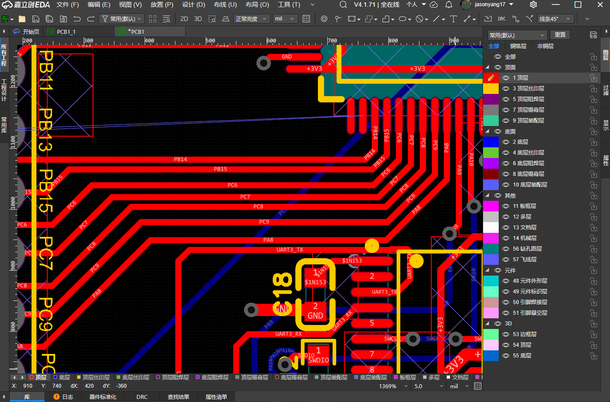
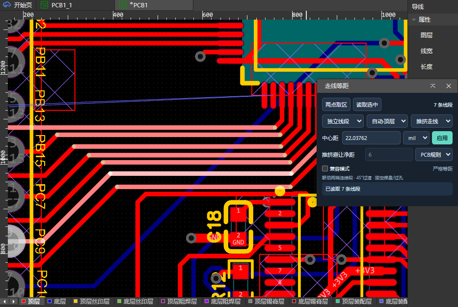
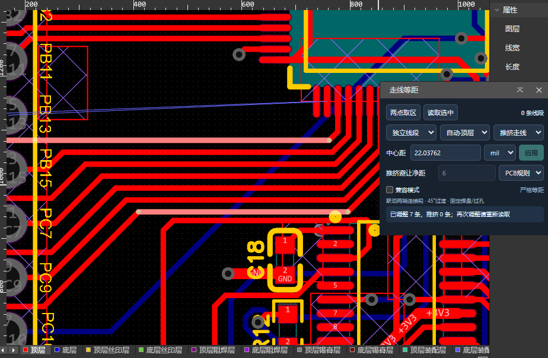

# Equal Line Spacing

[简体中文](README.md) | [English](README.en.md)

A PCB trace spacing extension for EasyEDA. Select a rectangular area with two clicks or read selected traces, then set a target centerline spacing to adjust complete routes or individual segments. Supports strict equal spacing, compatibility mode, automatic copper layer detection, and pushing surrounding traces.

## Demo

| Before adjustment | After adjustment |
| --- | --- |
|  |  |

## Usage

1. Open a PCB document, then open **Equal Line Spacing → Adjust Selected Line Spacing**. In the Chinese interface, the menu is **线段等距 → 调整选中线段间距**.
2. Choose **Complete routes (完整走线)** or **Individual segments (独立线段)**. The copper layer defaults to **Auto-detect (自动识别)**. Individual segment mode requires at least two parallel straight segments on the same layer; complete route mode expands targets along their connections.
3. Click **Two-point area (两点取区)** and click two opposite corners of a rectangle on the canvas. Alternatively, select traces on the canvas and click **Read selection (读取选中)**. The extension selects the identified targets on the canvas.
4. Enter the target **Centerline spacing (中心距)**, choose mil or mm, and enable **Compatibility mode (兼容模式)** if needed.
5. Choose **Direct adjustment (直接调整)** or **Push traces (推挤走线)**. Push clearance defaults to **PCB rules (PCB规则)**; choose **Manual (手动)** to enter a value instead.
6. Click **Apply (应用)** and check the result in the status area. Read the selection or select an area again before making another adjustment.

Complete the two-point selection within 30 seconds. Both rectangle dimensions must be at least 10 mil. Click the button again to cancel. A segment is matched when its copper width intersects the rectangle; the entire straight segment is selected without clipping it at the rectangle boundary.

Changing the scope or copper layer requires reading the targets again. If automatic detection finds eligible targets on multiple copper layers, it asks you to select a layer manually. Applying an adjustment uses the layer determined when the targets were read.

## Parameters

Length values default to mil and can be switched to mm. Existing values are converted when switching units.

| Parameter | Default | Description |
| --- | --- | --- |
| Selection scope | Individual segments | Adjusts only the matched parallel straight segments. Complete route mode expands targets along their connections. |
| Copper layer | Auto-detect | Detects the layer from the target traces. Supports top, bottom, and inner copper layers, with manual selection available. |
| Adjustment mode | Push traces | Tries to move surrounding traces that conflict with the adjustment. Direct adjustment updates only the targets and necessary connecting segments without automatically avoiding other copper objects. |
| Centerline spacing | 10 mil | Target centerline distance between adjacent main trace sections. Must be greater than 0. Transitions near fixed endpoints are not guaranteed to maintain equal spacing. |
| Unit | mil | Can be switched to mm. Centerline spacing and manual clearance use the same unit. |
| Push clearance | PCB rules | Displays the trace-to-trace clearance or range after reading the targets. Pads, vias, and board edges use their respective rules. Manual mode initially uses 6 mil and allows editing. Used only in push mode. |
| Compatibility mode | Off | When off, applies strict equal spacing. When on, expands only parallel sections with insufficient spacing and does not compress separate sections that already meet the target. |
